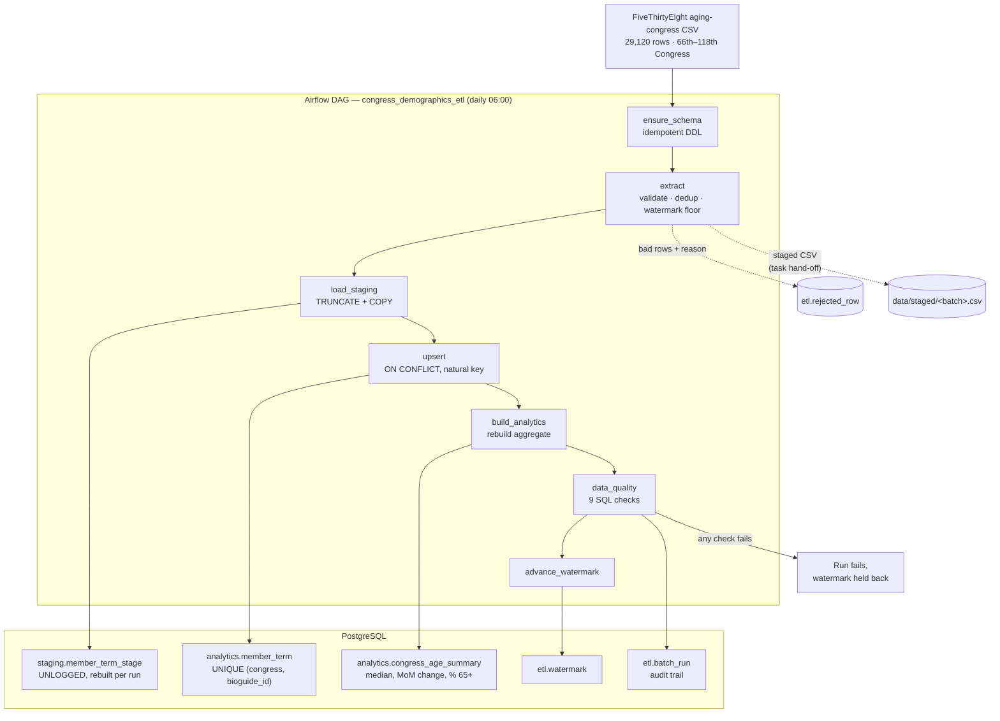

# airflow-postgres-etl

A daily batch ETL that loads 29,120 rows of US congressional demographics into
PostgreSQL, orchestrated by Airflow. Validate, stage with `COPY`, upsert on a
natural key, rebuild an aggregate model, verify, then advance the watermark.

The pipeline is **incremental** (congress number as watermark with revision
lookback), **idempotent** (natural-key upsert on `(congress, bioguide_id)`
that skips unchanged rows, verified by full re-process with identical
fingerprint), and **verified against PostgreSQL 16.15** — 156 tests, nine
data-quality checks, real data, and DAG execution.

**Architecture:** Seven-task DAG (ensure schema → extract → stage → upsert →
analytics → quality checks → advance watermark). File-based handoff between
tasks. Watermark advances only after quality checks pass. Duplicate input rows
handled by `DISTINCT ON`.

**Key design:** Deterministic natural key prevents re-processing duplicates.
Unchanged rows skip the upsert entirely so `updated_at` stays stable. Within-batch
duplicates collapsed before merge. Nine SQL checks verify structure, ranges, and
internal consistency before watermark moves.

> **Honest status.** The SQL, pipeline, and DAG all executed against
> PostgreSQL 16.15. `airflow dags test` completed all seven tasks successfully
> with 29,120 real rows processed. **The Docker Compose stack was never
> started** — no Docker daemon was available, so PostgreSQL was installed
> directly instead. `docker compose config` validates YAML/dependencies; it
> does not prove containers come up healthy. The Airflow *scheduler* was not
> run. See [`docs/VERIFICATION.md`](docs/VERIFICATION.md) for complete output.

---

## CI Status


---

## Architecture



Two details that matter more than the box count:

- **The watermark advances last**, only after the quality checks pass. A failed
  run is retried from the same position rather than skipping data. Even when
  `ETL_FAIL_ON_QUALITY_ERROR=false` logs failed checks as warnings, the final
  watermark task fails closed and records a failed batch instead of certifying
  unverified data.
- **Tasks hand off a file plus a batch id, not memory.** Airflow runs each task
  in its own process, so validated rows are written to a staged CSV that the
  load task `COPY`s. The CSV is published with an atomic rename so a failed
  write cannot expose a partial batch or overwrite a valid staged file. The
  file also survives as a debugging artefact.
- **Upstream CSV downloads are streamed to a temporary file** with a 20 MiB
  byte cap enforced as chunks arrive, rather than buffering the whole HTTP
  response. The entire UTF-8 CSV, header, and minimum row count are validated
  before atomic publication. Oversized, interrupted, empty, or malformed
  downloads leave the last-good raw snapshot untouched. This bounds response
  buffering, not downstream parser memory or total process memory.

## Quickstart

### With Docker (the intended path — untested here, see the status note)

```bash
git clone https://github.com/koushikchowdary6/airflow-postgres-etl.git
cd airflow-postgres-etl

cp .env.example .env          # set the four passwords
docker compose up -d
docker compose ps             # wait for every service to report healthy

open http://localhost:8080    # unpause congress_demographics_etl, or:
make trigger
```

### Without Docker (what was actually verified)

Any PostgreSQL 14+ will do.

```bash
python -m venv .venv && source .venv/bin/activate
pip install -r requirements-dev.txt

export POSTGRES_HOST=localhost POSTGRES_PORT=5432 \
       POSTGRES_DB=congress_etl POSTGRES_USER=etl POSTGRES_PASSWORD=...

make init-db      # schemas, tables, constraints, indexes
make run          # download, validate, load, verify
make rerun        # run again — proves nothing changes
make state        # watermark and batch history
make examples     # analytical queries
make test         # 133 tests (needs a database named *test*)
```

## What actually ran

| Check | Tool | Result |
|---|---|---|
| Unit tests (pure) | pytest 9.1.1 | **133 passed** |
| DAG tests with Airflow | pytest + Airflow 2.11.2 | **23 passed** |
| Lint and formatting | ruff 0.17.0 | **clean** (156 files) |
| Compose file validation | `docker compose config` | **valid** |
| Real data pipeline | PostgreSQL 16.15 | **29,120 rows, 0 rejected, 0 duplicates** |
| Data-quality checks | SQL | **9/9 pass** |
| Idempotency check | PostgreSQL 16.15 | **0 inserted, 0 updated, fingerprint identical** |
| DAG execution | `airflow dags test` | **7/7 tasks SUCCESS** |
| CI on GitHub Actions | postgres service + real tests | **passes** |
| `docker compose up` | — | **not run** (no daemon) |
| Airflow scheduler | — | **not run** |

## Data model

| Object | Purpose |
|---|---|
| `staging.member_term_stage` | One batch. `UNLOGGED` — truncated and rewritten every run, so WAL buys nothing. |
| `analytics.member_term` | Fact table. `UNIQUE (congress, bioguide_id)` plus five CHECK constraints. |
| `analytics.congress_age_summary` | Aggregate: member count, mean/median/min/max age, % aged 65+, change vs previous Congress. |
| `etl.watermark` | Highest `congress` loaded **and verified**. |
| `etl.batch_run` | One row per run: counts, status, timings, error. Makes "what happened last night" a query. |
| `etl.rejected_row` | Every rejected input row with its file row number, column, raw value and reason. |

Three indexes, each justified in `sql/001_schema.sql`; the unique constraint
already indexes `(congress, bioguide_id)`, so no separate index duplicates it.

## Design decisions worth questioning

**A natural key, not a surrogate key, for identity.** `(congress, bioguide_id)`
is verified unique across all 29,120 rows — checked, not assumed. The upsert
targets that constraint, so re-ingesting the same row lands on the same row.
The table also has an identity column as its primary key, for convenient
referencing, but identity comes from the business key.

**`congress` as the watermark, not a timestamp.** It is the dataset's own
monotonic integer: no timezones, no clock skew, no inclusive-boundary
ambiguity, and `118` is readable at a glance.

**A lookback window, not a strict `>` filter.** Published datasets get
corrected. Re-reading one Congress below the watermark catches a late fix; that
is only safe because the key is deterministic.

**Unchanged rows are not rewritten.** `ON CONFLICT ... DO UPDATE ... WHERE
(…) IS DISTINCT FROM (…)` means a no-op rerun leaves even `updated_at` alone.
"No duplicates" is the weak property; "nothing was touched" is the one verified.

**`DISTINCT ON` before the upsert.** Without it, a duplicated input row makes
PostgreSQL raise *"ON CONFLICT DO UPDATE command cannot affect row a second
time"*. There is a test for exactly this.

**`xmax = 0` in `RETURNING` to count inserts versus updates.** On a freshly
inserted row the system column `xmax` is 0; on an updated row it carries the
updating transaction id. That yields both counts from one statement.

**Validation in Python *and* in the database.** Python gives actionable
per-row rejects; CHECK constraints make the invariant true for anything that
writes, including a hand-typed `INSERT`. The quality checks then verify the
invariants held — and `test_quality.py` drops a constraint temporarily to prove
each check can actually fire, rather than being dead SQL.

**The DAG holds no logic and touches nothing at import time.** Every task calls
a function in `etl/`. `Config.from_env()` is called inside tasks, never at
module level: a DAG file that connects to a database while being parsed will
degrade the scheduler, which re-parses every file on a loop. `test_dag.py`
enforces this with AST checks.

**LocalExecutor, not Celery.** Single-machine stack; Redis and worker
containers would add moving parts without adding capability.

## Repository layout

```
dags/congress_demographics_etl.py   the DAG: 7 thin tasks, no business logic
etl/
  source.py       the one source feed, declaratively
  schema.py       validation, normalization, the canonical record
  extract.py      CSV -> validated records + rejects (pure, DB-free)
  db.py           connections and transactions
  load.py         COPY, upsert, analytics rebuild, batch audit
  watermark.py    incremental position
  quality.py      runs the SQL checks, decides pass/fail
  pipeline.py     the steps the DAG and CLI both call
  cli.py          init-db · fetch · run · quality · state · examples
sql/
  001_schema.sql  DDL: tables, constraints, indexes (idempotent)
  002_upsert.sql  the idempotent upsert
  003_analytics.sql  aggregate rebuild with window functions
  004_quality.sql    the nine checks
  005_example_queries.sql
docker-compose.yml  postgres + airflow-init + scheduler + webserver, with health checks
docker/init-databases.sh  creates roles and the three databases on first start
tests/              133 tests; unit tests need no database
.github/workflows/ci.yml  lint · tests (postgres service) · smoke test · DAG integrity
docs/               DATASETS.md · VERIFICATION.md
```

## Engineering scenarios, and where each is covered

| Scenario | Behaviour | Test |
|---|---|---|
| First run | 29,120 rows inserted, watermark set to 118 | `TestFirstRun` |
| Rerun, unchanged source | 0 inserted, 0 updated, fingerprint identical | `TestRepeatedRunUnchangedSource` |
| New incremental records | new rows inserted, corrections updated in place | `TestIncrementalRecords` |
| Duplicate input rows | collapsed by `DISTINCT ON`; no duplicate business rows | `test_within_batch_duplicates_do_not_break_the_upsert` |
| Missing required fields | row rejected with column and reason; batch continues | `TestMalformedAndDuplicateInput` |
| Invalid data types | rejected in Python; also blocked by CHECK constraints | `TestDatabaseConstraints` |
| Empty source file | 0 staged, warehouse untouched | `test_empty_source_leaves_the_warehouse_untouched` |
| Upstream drops a column | fails fast with the column named | `test_missing_column_fails_fast` |
| Partial failure | watermark held back, batch marked `failed` with the reason | `TestPartialFailureAndRecovery` |
| Restart after failure | re-running recovers; no manual cleanup | `test_rerunning_after_a_failure_recovers` |

## Recovery

Restarting is the whole procedure. Staging is truncated before each load, the
upsert is keyed on the natural key, the aggregate is rebuilt in full, and the
watermark only moves after verification — so re-running a failed task or the
whole DAG is safe and needs no cleanup.

To investigate first:

```sql
-- What happened, and did it fail?
SELECT * FROM etl.batch_run ORDER BY started_at DESC LIMIT 5;

-- Why were rows rejected?
SELECT column_name, reason, COUNT(*)
FROM etl.rejected_row
WHERE batch_id = (SELECT batch_id FROM etl.batch_run ORDER BY started_at DESC LIMIT 1)
GROUP BY 1, 2 ORDER BY 3 DESC;

-- Where is the pipeline up to?
SELECT * FROM etl.watermark;
```

To re-process everything from scratch:

```bash
python -m etl.cli run --full-refresh   # safe: the upsert makes it a no-op if nothing changed
```

## Troubleshooting

| Symptom | Cause and fix |
|---|---|
| `DatabaseUnavailable: Could not connect to …` | PostgreSQL is not running or `POSTGRES_*` is wrong. `docker compose ps`, or `pg_isready -h <host>`. The error prints the exact target, minus the password. |
| `ConfigError: POSTGRES_PASSWORD is not set` (exit 2) | Copy `.env.example` to `.env` and `set -a && . ./.env && set +a`. |
| `SchemaError: input is missing required column(s)` | Upstream changed its header. Compare against `required_columns` in `etl/source.py`. Deliberate: silent column loss is worse. |
| `Data-quality failure: …` (exit 1) | A check failed; the watermark was held back. Run the matching predicate from `sql/004_quality.sql` as a `SELECT` to list the rows. |
| `ON CONFLICT DO UPDATE command cannot affect row a second time` | Duplicate natural keys reached the upsert — the `DISTINCT ON` in `002_upsert.sql` was removed or bypassed. |
| Tests all skip | No database reachable. The suite skips rather than fails; CI treats skips as an error so this cannot hide there. |
| Tests refuse to run | Safety guard: the database name must contain `test`. Set `POSTGRES_DB=congress_etl_test`. |
| DAG missing from the UI | `PYTHONPATH` must include the project root so `etl` imports. Check `docker compose logs airflow-scheduler` for an import error. |
| DAG present but never runs | It is created paused (`DAGS_ARE_PAUSED_AT_CREATION`). Unpause it, or `make trigger`. |
| `docker compose up` fails on a variable | Every password in `.env.example` is required; compose fails fast rather than starting with an empty password. |

Exit codes: `0` success, `1` pipeline or data-quality failure, `2` configuration
or connection error.

## Known limitations

1. **The Docker stack is unproven.** `docker compose config` parses; nothing
   was ever started. Treat the Compose file as reviewed, not tested.
2. **The scheduler was never run.** `airflow dags test` runs tasks in-process,
   so scheduling, the executor, parallelism and the UI are unverified.
3. **Retries are configured but were never seen firing.** No transient failure
   was induced to watch one happen.
4. **Single-process extraction.** The CSV is read in one pass. Fine at ~29k
   rows; a feed in the millions wants chunked reads and a `COPY` straight from
   a stream.
5. **Full-file read every run.** The source publishes one cumulative file with
   no delta endpoint, so the pipeline re-reads it and filters by watermark.
6. **The aggregate is rebuilt in full.** Correct and cheap at ~106 rows; it
   would need an incremental refresh at a much larger grain.
7. **No concurrency protection beyond `max_active_runs=1`.** Two pipelines
   pointed at one database would contend on the staging table. A per-pipeline
   advisory lock would be the fix.
8. **Quality checks are not fact-checking.** They verify structure, ranges and
   internal consistency. A wrong-but-plausible birth date upstream loads
   cleanly and passes every check.
9. **No alerting.** A failure surfaces in the Airflow UI and `etl.batch_run`;
   nothing pages anyone. `on_failure_callback` would be the hook.

## Licence

Code: MIT ([`LICENSE`](LICENSE)). Data: FiveThirtyEight,
["Congress Today Is Older Than It's Ever Been"](https://github.com/fivethirtyeight/data/tree/master/congress-demographics),
used under CC BY 4.0. See [`docs/DATASETS.md`](docs/DATASETS.md).
